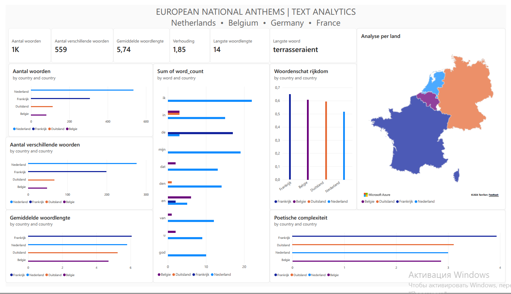

# European National Anthems | Text Analytics in Power BI

A comparative text-analytics project examining the national anthems of **the Netherlands, Belgium, Germany, and France**. Developed as part of the Post-HBO Big Data Business Analist coursework at Inholland Academy.

> **Screenshot note:** This is a cropped photograph of the original Power BI report. The editable report includes updated English visual headings. The screenshot is not a newly rendered export of that updated report; replace it with a direct Power BI screenshot after opening the project.

## Business / analytical question

How do the four national anthems compare in length, lexical diversity, word length, common vocabulary, and a simple constructed measure of textual complexity?

## Report features

- KPI cards: total word occurrences, unique words, mean word length, total-to-unique ratio, longest word length, and longest word.
- Country comparisons for word counts, unique words, mean word length, and vocabulary richness.
- Frequent-word distribution and a filled map of the countries.
- A custom **Poetic Complexity Index**, calculated as mean word length × vocabulary richness. **This is a project-defined heuristic, not a validated linguistic measure of poetic quality.**

## Metrics and definitions

| Metric | Implementation in the original Power BI model |
| --- | --- |
| Total Words | `SUM(All_Words[word_count])` |
| Unique Words | `DISTINCTCOUNT(All_Words[word])` |
| Average Word Length | `AVERAGE(All_Words[word_length])` |
| Words per Unique Word | Total Words / Unique Words |
| Vocabulary Richness | Unique Words / Total Words |
| Longest Word Length | `MAX(All_Words[word_length])` |
| Poetic Complexity Index | Average Word Length × Vocabulary Richness |

**Metric interpretation:** The original Power BI measure `AVERAGE(All_Words[word_length])` is the unweighted average across word-frequency rows. The Pig/Hive scripts additionally calculate a frequency-weighted mean, `SUM(word_length * word_count) / SUM(word_count)`, representing the average across word occurrences. These are intentionally distinct measures and should not be compared as though they were identical. The source model retains Dutch internal measure names so existing report references continue to work; English visual titles are provided for portfolio presentation.

## End-to-end analytical workflow

This project connects **text processing, data preparation, semantic modeling and business intelligence reporting**. The analysis follows the transformation of national-anthem texts into comparable word-level metrics and a country-level Power BI report.

1. **Problem framing:** define comparable indicators across four national anthems and identify the limitations of cross-language comparisons.
2. **Data preparation:** structure country-specific word records and metrics into tabular datasets suitable for analysis.
3. **Big-data coursework:** work with the Hadoop ecosystem, including **Apache Pig** and **Apache Hive**, to explore transformation and querying workflows. The coursework workflow used Hadoop, Pig and Hive before the results were exported to CSV for Power BI. The repository includes Pig and Hive scripts documenting the word-level analysis; original execution logs are not included.
4. **Power Query (M):** import and combine country-level data, prepare column types and establish a consolidated analytical table.
5. **DAX and modeling:** define word-count, lexical-diversity and derived comparison measures.
6. **Visual analytics:** build an interactive country comparison using KPIs, frequency charts and geographic context.
7. **Interpretation:** explain patterns while distinguishing exploratory indicators from validated linguistic conclusions.

## Technical stack

- **Power BI Desktop** and **DAX**
- **Power Query (M)** for combining country-level word tables
- **CSV** input tables (referenced by the Power Query model)
- **Apache Hadoop, Pig and Hive** — used in the coursework processing stage; corresponding analysis scripts are available in `pig/` and `hive/`.

## How to open

1. Download or clone the repository.
2. Open `EuropeanAnthems.pbip` in a recent Power BI Desktop version supporting PBIP / PBIR.
3. The Power Query sources currently refer to CSV files on the original computer (`C:\Users\Admin\Desktop\InHolland\...`). The four CSV files are included in the repository's `data/` folder. To refresh the model, update the four Power Query source paths to point to those downloaded files.
4. The included `anthem-portfolio-theme.json` can be imported manually using **View → Themes → Browse for themes** if you want to refine the visual palette further.
5. Check all visuals and replace `assets/Dashbord-preview.png` with a clean screenshot captured directly from the opened report.

## Data and interpretation caveats

- This is a four-country educational comparison, not a representative sample of all European national anthems.
- Tokenization, text normalization, and source-text versions are not verifiable from the provided project archive alone.
- Some metrics are aggregated over the combined table; country selections change their meaning.
- Basemap place-name language may follow the Power BI map service, locale, and client settings rather than the report's English titles.
- The model retains machine-specific CSV source paths; refresh requires updating them to the four CSV files included in `data/`.

## Repository contents

- `EuropeanAnthems.pbip` — Power BI project entry point
- `EuropeanAnthems.Report/` — editable PBIR report definition
- `EuropeanAnthems.SemanticModel/` — Power BI semantic model and DAX measures
- `anthem-portfolio-theme.json` — optional navy / gold theme
- `assets/Dashbord-preview.png` — source-derived preview photo
- `data/` — four country-specific CSV inputs
- `pig/anthem_analysis.pig` — word-frequency aggregation in Apache Pig
- `hive/anthem_analysis.hql` — Hive external tables and country metrics
- `PROCESSING_GUIDE.md` — setup, definitions and reproducibility limitations

## Opening and refreshing the report

To refresh on a different computer, update the four Power Query file paths to the CSV files in `data/`. A clean screenshot can be exported from Power BI Desktop after opening the report. The included preview remains the original project screenshot.
